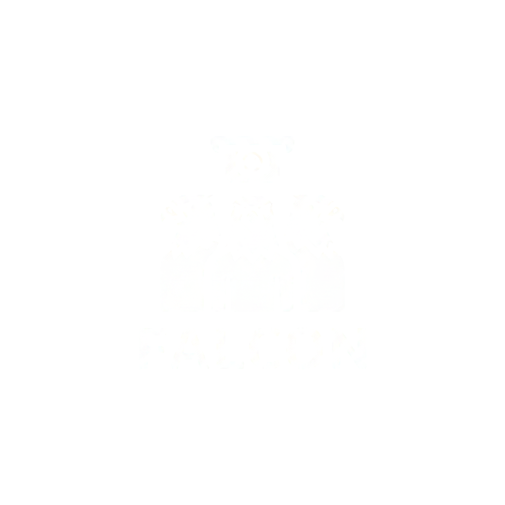
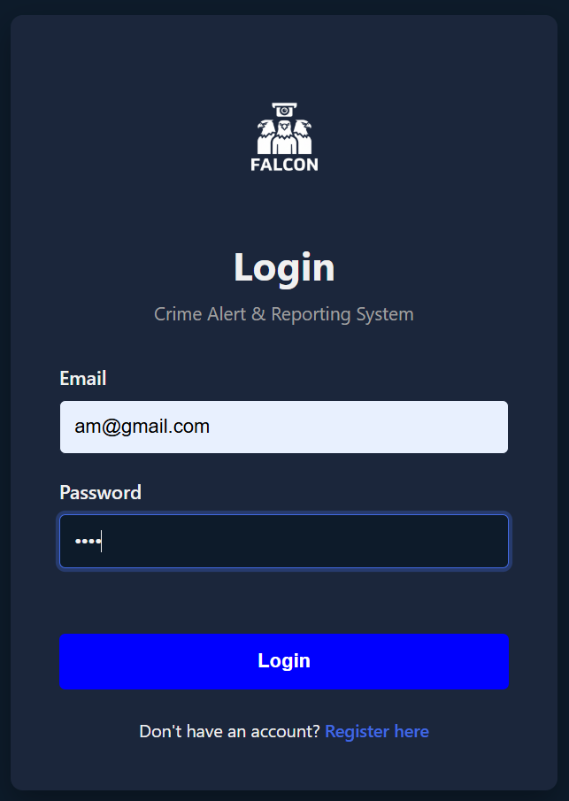
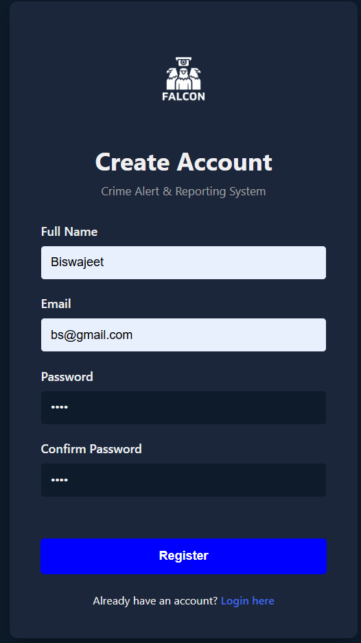
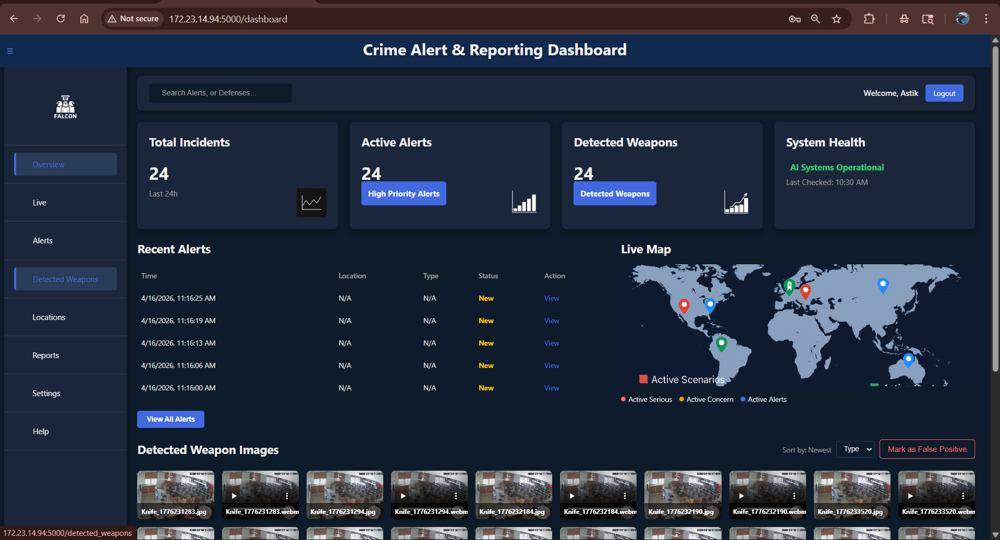
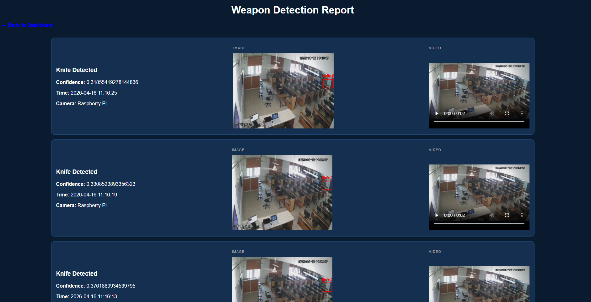
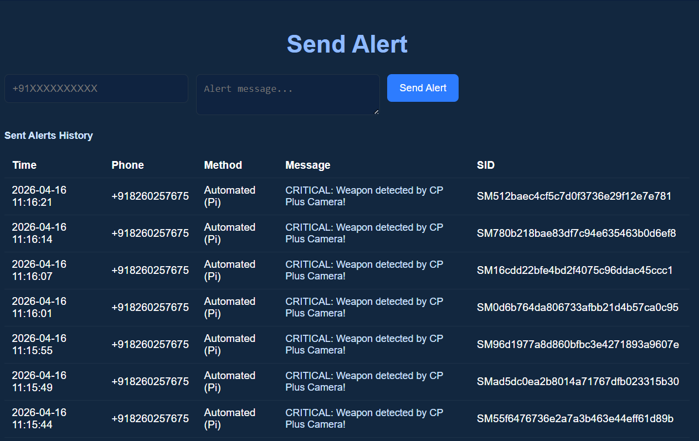

<p align="center">
  
</p>

<h1 align="center">🦅 FALCON</h1>

<h3 align="center">
Automatic Crime Alert and Reporting System
</h3>

<p align="center">
Real-Time Weapon Detection using YOLOv8 • Flask • OpenCV • Raspberry Pi • Twilio
</p>

<p align="center">


</p>

---

# 📑 Table of Contents

- Overview
- Problem Statement
- Solution
- Features
- System Architecture
- Detection Methodology
- Technology Stack
- Hardware Requirements
- Software Requirements
- Project Structure
- Screenshots
- Installation
- Configuration
- Running the Project
- Workflow
- Model Performance
- Security
- Limitations
- Future Roadmap
- Contributing
- License
- Author

---

# 📖 Overview

FALCON (Automatic Crime Alert and Reporting System) is an AI-powered surveillance and emergency response platform designed to detect dangerous objects such as weapons in real-time using computer vision and deep learning techniques.

The system uses a custom-trained YOLOv8 object detection model to analyze live camera feeds, identify potential threats, capture evidence, store detection records, and automatically notify authorized personnel through Twilio SMS alerts.

Unlike traditional CCTV systems that only record incidents and require continuous human monitoring, FALCON performs automated threat detection and rapid response using Artificial Intelligence.

The system combines:

- Computer Vision
- Deep Learning
- Edge AI Processing
- Real-Time Video Analysis
- Backend Development
- Database Management
- Automated Alert Generation

The project is designed for real-world surveillance applications including smart security systems, public safety monitoring, and emergency response solutions.

---

# ❗ Problem Statement

Traditional CCTV surveillance systems only provide video recording capabilities.

Although cameras continuously monitor environments, identifying dangerous activities still depends on human operators. This creates several problems:

- Delayed threat identification
- Slow emergency response
- Human monitoring limitations
- Difficulty reviewing large amounts of recorded footage
- Lack of automated incident reporting

In critical situations involving weapons or violent activities, even a few seconds of delay can increase the severity of an incident.

FALCON addresses this challenge by introducing an AI-based automated surveillance system capable of detecting threats, generating alerts, and maintaining digital incident records.

---

# 💡 Solution

FALCON provides an automated AI surveillance pipeline:

1. Camera captures live video input.
2. OpenCV extracts video frames.
3. YOLOv8 analyzes each frame for weapon detection.
4. Detection results are evaluated using confidence thresholds.
5. When a threat is detected:
   
   - Evidence image is captured
   - Detection information is stored
   - Incident details are recorded
   - Twilio sends SMS alerts
   - Dashboard is updated

The system continuously monitors the environment and performs real-time threat detection without requiring constant human supervision.

---

# ✨ Features

## 🤖 AI-Based Weapon Detection

- Real-time weapon detection using YOLOv8
- Custom-trained object detection model
- Bounding box visualization
- Confidence score calculation
- Image and video evidence capture
- Automated threat identification

## 🎥 Real-Time Surveillance

- USB camera support
- RTSP/IP camera support
- Live video stream processing
- Frame-by-frame AI analysis
- Raspberry Pi compatible edge deployment

## 🚨 Automated Alert System

- Instant SMS notification using Twilio API
- Threat detection timestamp
- Detection information sharing
- Emergency response notification

## 📊 Dashboard and Reporting

- Web-based monitoring dashboard
- Detection history tracking
- Incident reports
- Captured evidence management
- Detection statistics

## 👤 Authentication System

- User registration
- Secure login system
- Password encryption
- Session management
- Protected dashboard access

## 🗄 Database Management

- SQLite database integration
- Detection record storage
- Alert history management
- User information management

## 🖥 Edge AI Deployment

- Raspberry Pi compatible architecture
- Local AI inference
- Reduced response latency
- No dependency on cloud processing
- Better privacy and security

---

# 🏗 System Architecture

```
                    IP Camera / USB Camera
                            │
                            ▼
                    RTSP Video Stream
                            │
                            ▼
                    OpenCV Frame Capture
                            │
                            ▼
                    Image Preprocessing
                            │
                            ▼
                    YOLOv8 Detection Model
                            │
                            ▼
                 Object + Confidence Analysis
                            │
                            ▼
                    Threat Decision Logic
                            │
             ┌──────────────┴──────────────┐
             ▼                             ▼

     Capture Evidence              Generate Alert
     Image / Video                 Twilio SMS

             │                             │
             ▼                             ▼

        SQLite Database             Emergency Contact

             │
             ▼

       Flask Web Dashboard

             │
             ▼

     Reports and Incident History

The complete system works as a continuous AI surveillance loop:

Camera Input → Frame Processing → Object Detection → Threat Analysis → Evidence Storage → Alert Generation → Reporting
```

# 🧠 Detection Methodology

## 1. Video Input Acquisition

The system receives live video input from:

- IP Camera through RTSP protocol
- USB Camera

RTSP provides continuous real-time video transmission with low delay.

## 2. Frame Extraction

OpenCV captures the incoming video stream and converts it into individual frames.

Example:

30 FPS video = 30 individual images processed every second.

## 3. Image Preprocessing

Before AI processing:

- Frames are resized
- Pixel values are optimized
- Input format is prepared for YOLOv8

## 4. YOLOv8 Object Detection

The YOLOv8 model analyzes each frame and identifies possible weapons.

The model returns:

- Object class
- Bounding box coordinates
- Confidence score

Example:

Weapon Detected

Confidence: 92%

## 5. Threat Decision Logic

The system does not generate alerts for every detection.

A confidence threshold is applied:

Example:

Confidence > 60%

AND

Object = Weapon

Then:

Threat Confirmed

## 6. Evidence Generation

After threat confirmation:

- Detection image is captured
- Bounding box is stored
- Timestamp is recorded
- Incident data is saved

## 7. Alert Generation

The Flask backend triggers Twilio SMS notification containing:

- Threat information
- Detection time
- Camera information

## 8. Database Storage

Detection information is stored in SQLite:

- Date and time
- Detected object
- Confidence score
- Evidence path

---

# 🛠 Technology Stack

| Layer | Technology |
|---------|------------|
| Programming Language | Python |
| Backend Framework | Flask |
| Frontend | HTML, CSS, JavaScript |
| AI Model | YOLOv8 (Ultralytics) |
| Computer Vision | OpenCV |
| Deep Learning Framework | PyTorch |
| Database | SQLite |
| Camera Streaming | RTSP |
| Alert System | Twilio API |
| Dataset Annotation | Roboflow |
| Hardware Deployment | Raspberry Pi |
| Version Control | Git & GitHub |

---

# 🔩 Hardware Requirements

## Development System

Recommended:

- Processor: Intel i5 / Ryzen 5 or above
- RAM: 8GB minimum
- Storage: 10GB+ free space
- Operating System: Windows/Linux

## Edge Deployment System

### Raspberry Pi 5

Specifications:

- Raspberry Pi 5
- 8GB RAM
- Camera module/IP Camera
- MicroSD Card
- Power supply
- Network connectivity

## Camera Requirements

Supported:

- USB Camera
- IP Camera
- RTSP-enabled CCTV Camera

# 💻 Software Requirements

- Python 3.10+
- Flask
- OpenCV
- Ultralytics YOLOv8
- PyTorch
- SQLite
- Twilio API
- Git
- Visual Studio Code

# 📂 Project Structure


FALCON/

│
├── AI/
│   │
│   ├── __init__.py
│   ├── yolo_detect.py
│   ├── live_rtsp_detector.py
│   ├── train_yolo.py
│   │
│   └── models/
│       └── best.pt
│
├── alerts/
│   │
│   ├── __init__.py
│   └── twilio_alert.py
│
├── database/
│   │
│   ├── __init__.py
│   ├── detection_db.py
│   ├── alert_db.py
│   ├── add_users.db
│   ├── detections.db
│   └── alerts.db
│
├── media/
│   │
│   └── output/
│
├── screenshots/
│
├── static/
│
├── templates/
│
├── train_detect_weapons/
│   │
│   ├── data.yaml
│   └── dataset/
│
├── app.py
├── config.py
├── run.py
├── requirements.txt
├── .env
├── .gitignore
└── README.md

---

## Screenshots

### Login


### Register


### Dashboard


### Detection Report


### Alert


---

# ⚙ Installation

```bash
git clone https://github.com/Astik97/FALCON.git

cd FALCON
```

Create virtual environment

Windows

```bash
python -m venv venv
```

```bash
venv\Scripts\activate
```

Linux

```bash
python3 -m venv venv
```

```bash
source venv/bin/activate
```

Install dependencies

```bash
pip install -r requirements.txt
```

---

# 🔐 Environment Variables

Create a `.env` file inside the project root directory.

Example:

```env

SECRET_KEY=your_secret_key

MODEL_PATH=AI/models/best.pt

# Twilio Configuration

TWILIO_ACCOUNT_SID=your_account_sid

TWILIO_AUTH_TOKEN=your_auth_token

TWILIO_PHONE_NUMBER=your_twilio_number

ALERT_RECEIVER_NUMBER=receiver_number
```

---

# ▶ Running the Project

```bash
python app.py
```

Open

```
http://127.0.0.1:5000
```

FALCON provides a central launcher using `run.py`.

Start the system:

```bash
python run.py
```

---

# 🔄 Workflow

```

                Start System

                     │

                     ▼

             Camera Initialization

                     │

                     ▼

             OpenCV Video Capture

                     │

                     ▼

              Extract Video Frames

                     │

                     ▼

              YOLOv8 Prediction

                     │

                     ▼

        Weapon Object Detected?

              │              │

             No             Yes

              │              │

              │              ▼

              │       Capture Evidence

              │              │

              │              ▼

              │       Save Image/Video

              │              │

              │              ▼

              │       Store Detection Data

              │              │

              │              ▼

              │       Twilio SMS Alert

              │              │

              └──────────────┘

                     │

                     ▼

            Update Dashboard

                     │

                     ▼

             Generate Reports

```

---

# 📈 Model Performance

| Metric | Value |
|---------|---------|
| Model | YOLOv8 |
| Dataset | Custom Weapon Dataset |
| Annotation Tool | Roboflow |
| Training Framework | Ultralytics |
| Image Size | 640x640 |
| Epochs | 50 |
| Precision | 85% |
| Recall | 75% |
| mAP@0.5 | 81% |

Performance may vary depending on:

- Hardware capability
- Camera quality
- Lighting conditions
- Detection confidence threshold
- Model optimization

---

# ⚡ Performance Benchmark

| Device | FPS | Latency | Expected Capability |
|--------|------|--------|---------------------|
| GPU System | 15–25 | 40–60 ms | Faster YOLO inference |
| Desktop CPU | 5–10 | 120–200 ms | Development and testing |
| Raspberry Pi | 1–3 | 400–800 ms | Edge AI deployment with optimization |

Performance depends on:

- YOLO model size
- Input resolution
- Camera FPS
- Optimization method
- Hardware acceleration

---

# 🔒 Security

FALCON follows security practices to protect system data, credentials, and access.

## Authentication Security

- User registration system
- Password hashing
- Secure session management
- Protected dashboard access

## Data Security

- Environment variables used for sensitive credentials
- API keys excluded from GitHub
- Database access controlled through backend modules
- Secure configuration management

## AI System Security

- Local inference support
- Reduced dependency on external cloud services
- Evidence stored locally
- Controlled access to detection records

## Deployment Security

Recommended production improvements:

- HTTPS implementation
- Firewall configuration
- Role-based access control
- Database encryption
- Secure API authentication

---

# ⚠ Limitations

Although FALCON provides automated AI-based surveillance, some limitations exist:

## Detection Limitations

- Accuracy depends on dataset quality
- False positives may occur
- Poor lighting can reduce detection performance
- Small or hidden objects may be difficult to detect

## Hardware Limitations

- Raspberry Pi has limited computational power
- High-resolution streams require optimization
- Multiple camera processing requires additional resources

## Environmental Limitations

- Camera positioning affects detection accuracy
- Network stability is required for RTSP cameras
- Extreme weather conditions may affect camera performance

## Alert Limitations

- Twilio requires internet connectivity
- SMS delivery depends on network availability
---

# 🗺 Future Roadmap

FALCON is designed as an expandable AI surveillance platform.

Future development will focus on improving intelligence, scalability, and real-world deployment.

# Phase 1: System Improvement

## Backend and AI Enhancement

- Improve YOLOv8 model accuracy
- Increase detection speed
- Optimize database operations
- Improve dashboard analytics
- Add advanced reporting system
- Improve authentication security

# Phase 2: Edge AI Deployment

## Raspberry Pi Production Deployment

- Deploy complete system on Raspberry Pi 5
- Optimize YOLO using ONNX
- TensorRT acceleration support
- Multi-camera monitoring
- Real-time WebSocket communication
- Offline edge inference

# Phase 3: Advanced AI Surveillance

## Intelligent Threat Analysis

- Person detection and tracking
- Suspicious activity detection
- Behaviour analysis
- Threat scoring system
- Multiple object tracking
- Crime pattern analysis

# Phase 4: Smart City and Enterprise Deployment

## Large Scale Architecture

- Cloud deployment
- Distributed surveillance network
- Mobile application
- GPS location tracking
- Google Maps integration
- Enterprise monitoring dashboard
- Smart city security integration

---

# 🤝 Contributing

Contributions, issues, and feature requests are welcome.

Steps:

Fork the repository.

Create a feature branch.

Commit your changes.

Open a Pull Request.

```bash
git checkout -b feature/new-feature
```

---

# 📄 License

This project is licensed under the MIT License.

You are free to:

- Use
- Modify
- Distribute
- Improve

provided that proper credit is given.

---

# 👨‍💻 Author

## Astik Mohapatra

Backend Developer • AI Systems Developer • Computer Vision Enthusiast

📧 Email:

astikm7007@gmail.com

🔗 LinkedIn

https://linkedin.com/in/astik-mohapatra

🐙 GitHub

https://github.com/Astik97

---

# ⭐ Support

If you find this project useful:

⭐ Star the repository

🍴 Fork the repository

📢 Share the project

Built with:

Python • YOLOv8 • OpenCV • Flask • SQLite • Twilio • Raspberry Pi

🦅 FALCON

Automatic Crime Alert and Reporting System